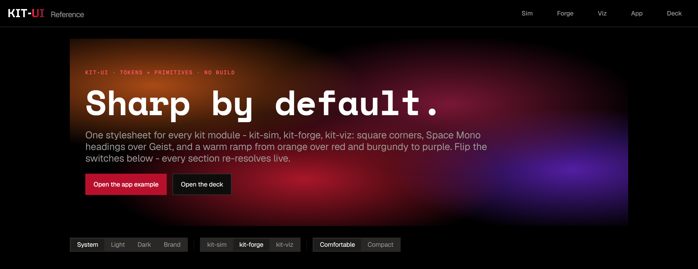

# kit-ui

[](https://cybernaut0815.github.io/kit-UI_template/examples/)

Design tokens and CSS primitives for the kit modules - kit-sim, kit-forge and kit-viz: square corners, Space Mono headings over Geist, dark by default, and a warm ramp from orange over red and burgundy to deep purple. One stylesheet, no build, no dependencies.

**Live examples:** <https://cybernaut0815.github.io/kit-UI_template/examples/> (GitHub Pages). Or open [`examples/index.html`](examples/index.html) straight from disk to see every token and primitive, with live theme, kit and density switches. [`examples/app.html`](examples/app.html) is a tool page and [`examples/deck.html`](examples/deck.html) a slide deck.

The three kit test pages show each family in its own preset:

| Page | Preset | Example |
| --- | --- | --- |
| [`kit-sim.html`](examples/kit-sim.html) | KIT-SIM | Simulation: a daylight field over a site |
| [`kit-forge.html`](examples/kit-forge.html) | KIT-FORGE | Generation: a live parcel subdivision with variants |
| [`kit-viz.html`](examples/kit-viz.html) | KIT-VIZ | Visualization: a dashboard with bar, line, heatmap and diverging charts |

Every chart and colour on those pages comes from the tokens.

The app-bar lockup is `<span class="kit-mark">kit-<span class="kit-mark__name">sim</span></span>`. It renders KIT-SIM, with the kit name in the kit's colour.

## Install

```jsonc
"dependencies": { "kit-ui": "github:Cybernaut0815/kit-UI_template#v0.1.0" }
```

Pin a tag so an update never silently changes a page. Then load it once, before your own CSS:

```js
import 'kit-ui'; // Vite, Next or any bundler
```

```html
<!-- plain HTML; the fonts resolve relative to this file -->
<link rel="stylesheet" href="./node_modules/kit-ui/css/kit-ui.css">
```

`kit-ui/tokens.css` is the variables alone, for a page that wants the tokens without the primitives.

## Declare the identity on `<html>`

```html
<html lang="en" data-kit="sim" data-density="compact">
```

| Attribute | Options | Effect |
| --- | --- | --- |
| `data-kit` | `sim` · `forge` (default) · `viz` | The product family: accent, gradient partner and signature `.grad-kit`. kit-sim is orange, kit-forge red, kit-viz purple |
| `data-theme` | `dark` · `light` | Leave it off to follow the system setting; dark is the default |
| `data-surface` | `brand` | Black-first surface for decks and heroes, in both themes; wins over `data-theme` on the same element |
| `data-density` | `compact` | Controls and table rows from 44 to 36 px |

Everything inside inherits. An element with its own `data-theme` is an island (a light card on a dark deck). Put `data-kit` on `<html>` or beside a `data-theme`. A theme toggle sets `data-theme`; removing it hands the choice back to the system.

## What is in it

- **Tokens** ([`css/tokens.css`](css/tokens.css)): surfaces, text, borders, accent, intent, the warm palette (orange, red, burgundy, purple), kit presets, chip hues, chart ramps, space, `--radius`, type, motion, shadows.
- **Primitives** ([`css/kit-ui.css`](css/kit-ui.css)): buttons, inputs, chips, segmented controls, cards, stats, badges, tables, alerts, toasts, progress, spinners, skeletons, app shell, sidebar, tabs, breadcrumb, pagination, native `<dialog>` and `[popover]` menus, and a composition layer (`.container .stack .cluster .grid .section .split .toolbar .form-grid .hero`). Element defaults sit at zero specificity, so any rule of yours wins.
- **Gradients**, multi-stop in oklch:
  - `.grad-spectrum`: orange → red → burgundy → purple
  - `.grad-ember`: orange → red
  - `.grad-dusk`: red → burgundy → purple
  - `.grad-kit`: the current kit's signature
  - `.grad-aurora`
  - `.grad-wash` and `.grad-glow`, for work surfaces
- **Fonts**, self-hosted under the SIL Open Font License ([`css/fonts/OFL.txt`](css/fonts/OFL.txt)):
  - Geist (body and controls)
  - Geist Mono (code)
  - Space Mono bold (headings)
  - Tektur (the KIT lockup only)
- **App bar**: solid black in every theme. The lockup sets KIT- in white and the kit word in the kit's gradient, and the gradient sweeps left over KIT- on hover. Buttons take the centre colour of the kit gradient.
- **Tool layout**: `.split--fill` with `.panel` sidebars and a `.viewport` runs edge to edge under the bar.

Corners are square: `--radius` is `0`. Set `--radius: 2px` on `<html>` to soften a whole app, never per component. The danger button is outlined, so it never reads as the red primary.

The full class and variable list is [`skills/kit-ui/reference.md`](skills/kit-ui/reference.md).

## With a coding agent

The agent skill in [`skills/kit-ui/`](skills/kit-ui/SKILL.md) holds the setup, page skeletons, rules and ship checklist. Install it into a project with:

```sh
npx skills add Cybernaut0815/kit-UI_template
```

## GitHub Pages

The examples are static files with relative paths, so GitHub Pages serves them as they are. Over https the fonts load in every browser, Firefox included.

To publish:

1. Open the repo **Settings → Pages**.
2. Under **Build and deployment**, set the source to **Deploy from a branch**.
3. Pick **main** and **/ (root)**, then save.

The root `index.html` forwards to `examples/`, and `.nojekyll` serves the files untouched.

## Develop

```sh
npm test
```

One zero-dependency `node:test` file checks:

- WCAG contrast for every theme (system dark and light, explicit, brand) and every kit;
- that the page is dark by default and follows the system;
- that every class appears in the reference and every `var()` is declared;
- that the examples use no colour literals;
- that no trace of the former company identity remains.

For any colour change, also open the three examples in light, dark and brand and look.

Known limit: Firefox may refuse fonts loaded from a parent folder over `file://`, so the examples fall back to the system font there. Chrome and Edge load them, and every browser does over http.
